<!-- Header banner -->

  

<h1 align="center">Hi 👋, I'm Mustavi Ibne Masum</h1>
<h3 align="center">Master's student in Computer Science at Lakehead University</h3>

  
  

---

### 🧑‍🔬 About me

- 🎓 Graduate student and researcher at **Lakehead University**, Canada
- 🔭 Research interests: **quantum machine learning**, **wireless channel estimation (OFDM / CSI)**, **underwater communication channels**
- 🧑‍🏫 Teaching Assistant
- 💬 Ask me about **C, C++, Python**
- 📫 Reach me at **mustavi.sadim99@gmail.com**
- 📄 My resume: [View on Google Drive](https://drive.google.com/file/d/1bzcoeJM3S6fPFZW5Va1fMm1MbnqedKUQ/view?usp=sharing)
- 👨‍💻 All my projects: [Repositories](https://github.com/Mustavi-99?tab=repositories)

 

### 🤝 Connect with me

  
  
  
  

### 🛠️ Languages and Tools

  
  
  
  
  
  
  
  
  
  
  
  
  
  
  
  
  

### 📊 GitHub Stats

<!-- These SVGs are generated by .github/workflows/readme-stats.yml (runs daily). -->

  
  

